<p align="center">
  <picture>
    <source media="(prefers-color-scheme: dark)" srcset="docs/assets/logo-dark.svg">
    
  </picture>
</p>

<p align="center">
  <b>IoT cold-chain monitor for vaccines and insulin.</b><br>
  ESP32 fridge nodes · heat-exposure budgets · signed telemetry · tamper-evident logs · 30-minute breach forecast
</p>

<p align="center">
  <a href="https://coldchain-monitor-30qu.onrender.com"></a>
  <a href="https://github.com/Pranto-404/Coldchain/actions/workflows/tests.yml"></a>
  <a href="https://github.com/Pranto-404/Coldchain/tags"></a>
</p>

<p align="center">
  
  
  
  
  
  
</p>

<p align="center">
  <a href="#-try-it">Try it</a> ·
  <a href="#-what-it-does">Features</a> ·
  <a href="#-screenshots">Screenshots</a> ·
  <a href="#-architecture">Architecture</a> ·
  <a href="#-how-it-works">How it works</a> ·
  <a href="#-run-it-yourself">Run it</a> ·
  <a href="#-project-layout">Layout</a>
</p>

<p align="center">
  <picture>
    <source media="(prefers-color-scheme: light)" srcset="docs/screenshots/overview-light.jpg">
    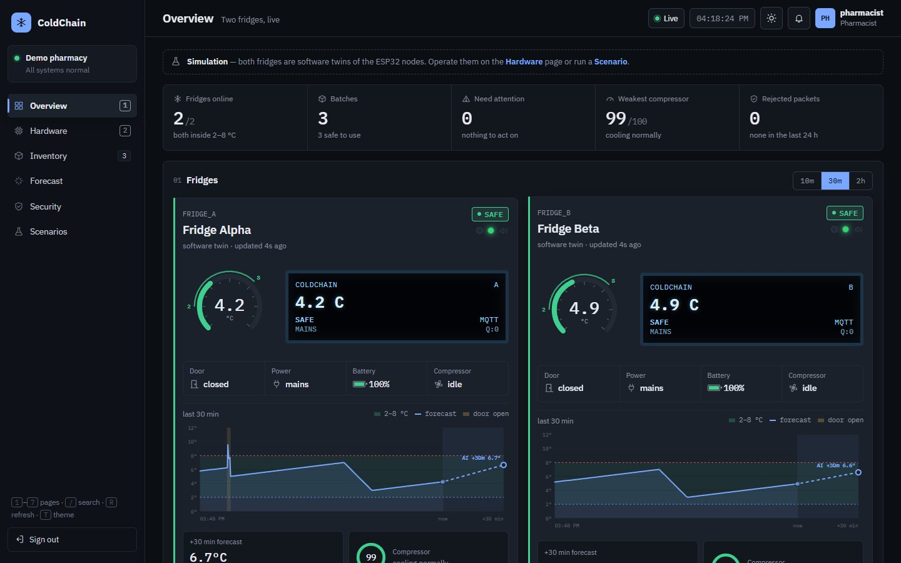
  </picture>
</p>

---

Vaccines and insulin lose potency outside **2–8 °C**, and the damage is invisible. ColdChain watches every
fridge, counts how long each batch has spent too warm, keeps the compressor cycling, survives power and
Wi-Fi loss, and warns half an hour **before** a breach — with an audit trail nobody can quietly edit.

Built for **FastRoboX 1.0** (IoT cold-chain challenge, Round 1).

## ⚡ Try it

**Live:** **https://coldchain-monitor-30qu.onrender.com** — free hosting sleeps when idle; the first visit can take ~50 s while it wakes.

| Enter as | What you can do |
|---|---|
| **Admin** | Everything: approve users, reset discard latches, run the tamper test |
| **Pharmacist** | Add / edit / move stock, confirm relocations, operate the simulated hardware |
| **Inspector** | Read-only: telemetry, audit log, integrity check |

Click a role on the sign-in page, or **create an account** — new accounts are read-only until an Admin approves Pharmacist access.

Things to try: open the **Hardware** page and click the fridge door · drag the probe-temperature slider past 8 °C ·
on **Security**, fire a replay attack, then *Tamper a reading* and press *Verify integrity* · toggle dark/light with <kbd>T</kbd>.

> The online demo runs two software twins of the ESP32 nodes. Data is simulated and resets when the server restarts.

## ✨ What it does

| Challenge task | What ColdChain does |
|---|---|
| **1 · Fridge node** | ESP32 + DS18B20, door reed switch, compressor relay, red/green LEDs, buzzer, SSD1306 OLED showing *Safe / Warning / Breach*. MQTT every 5 s **and** immediately on a door change. Thermostat **on ≥ 7 °C, off ≤ 3 °C, 60 s minimum off-time**. |
| **2 · Heat-exposure budget** | 60 weighted minutes above 8 °C per batch; minutes above 12 °C count **double**. Under 20 % → *At risk*; 0 % → *Discard* with the red LED **latched until an Admin resets it**. Budget follows the batch when it moves. |
| **3 · Power & offline** | Mains-fail button reports battery mode and level. Readings queue in flash (LittleFS, 900 samples ≈ 75 min) and replay **in order, without duplicates**. Door open > 60 s → buzzer + Telegram/email alert. |
| **4 · Web application** | JWT + bcrypt with Admin / Pharmacist / Inspector, enforced on the server. Live dashboard, inventory with moves, public **QR check** page, HMAC-SHA256 + timestamp + nonce with logged rejections, **SHA-256 hash chain** with *Verify integrity*. |
| **5 · AI prediction & relocation** | Random-forest forecast of the temperature **30 minutes ahead**, compressor **health 0–100**, suggestions of **which batches to move and where**, one-click confirmation, and a model report (dataset, features, results). |

Plus: interactive hardware view you can operate by hand, dark and light themes, account sign-up with approval,
notification centre, CSV export, keyboard shortcuts and a phone-friendly layout.

## 📸 Screenshots

<table>
  <tr>
    <td width="50%">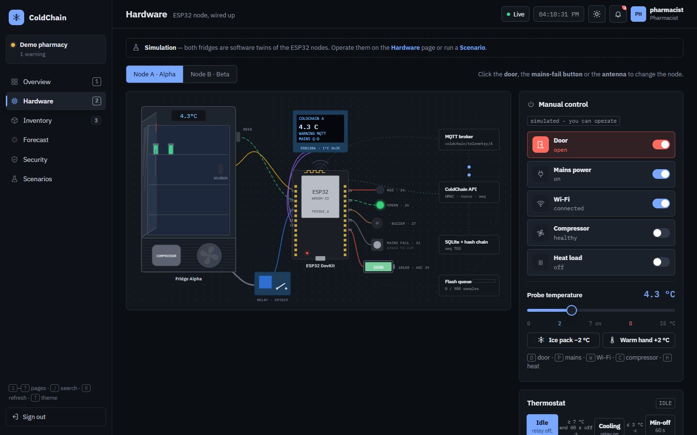<br><sub><b>Hardware</b> — the ESP32 node, wired up and operable by hand</sub></td>
    <td width="50%">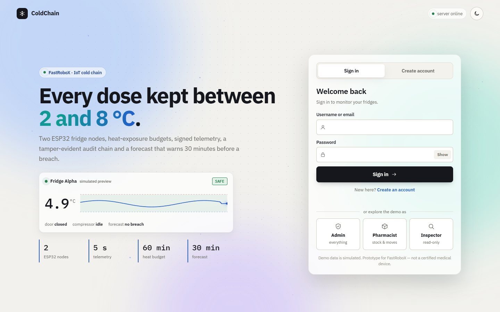<br><sub><b>Front page</b> — sign in, create an account, or enter as a demo role</sub></td>
  </tr>
  <tr>
    <td>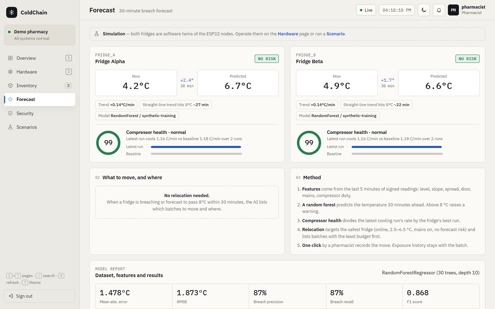<br><sub><b>Forecast</b> — now vs +30 min, compressor health, model report</sub></td>
    <td>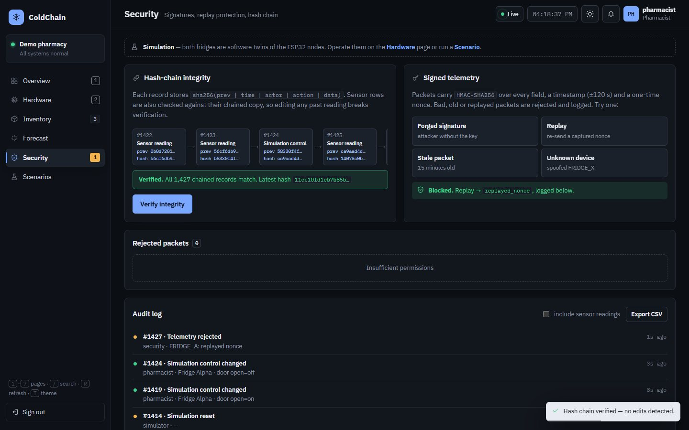<br><sub><b>Security</b> — blocked replay, hash-chain verification</sub></td>
  </tr>
  <tr>
    <td>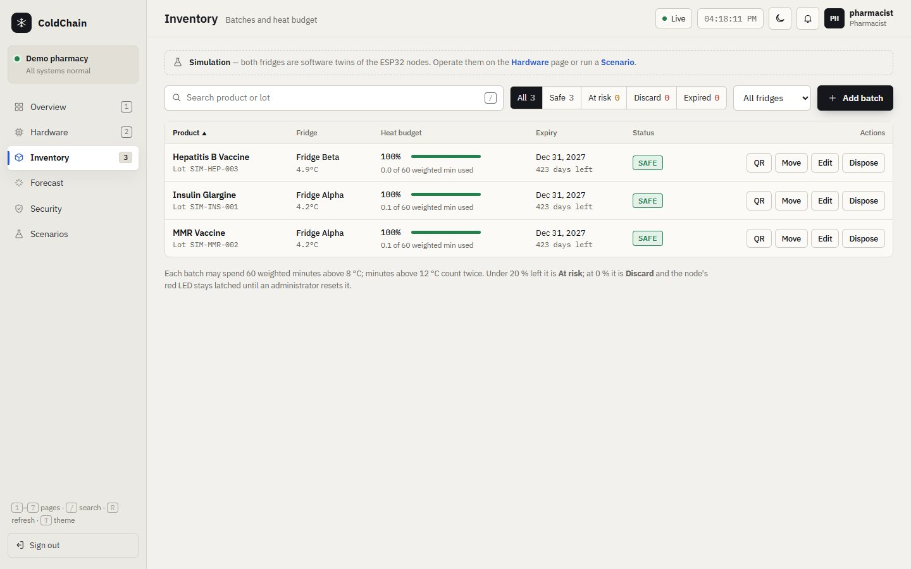<br><sub><b>Inventory</b> — heat budget, expiry, QR, move / edit / dispose</sub></td>
    <td>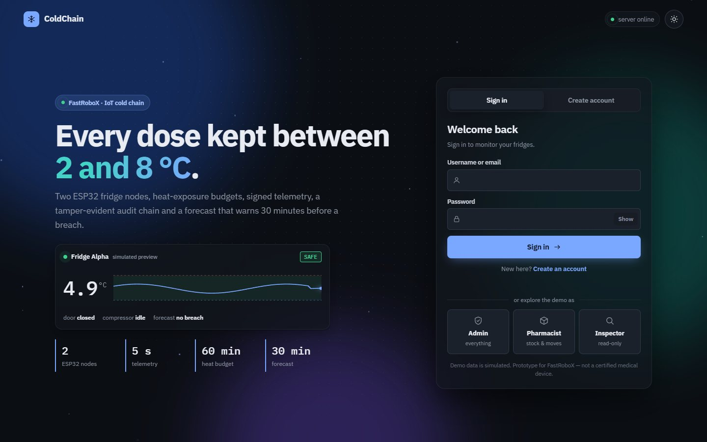<br><sub><b>Dark mode</b> — every screen has both themes</sub></td>
  </tr>
</table>

<p align="center">
  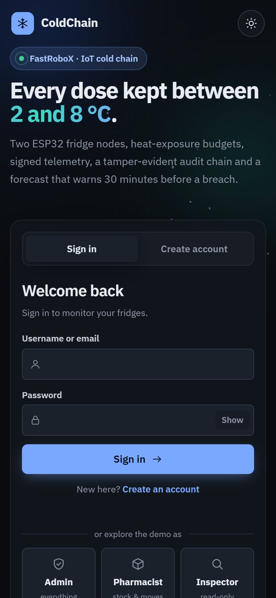
  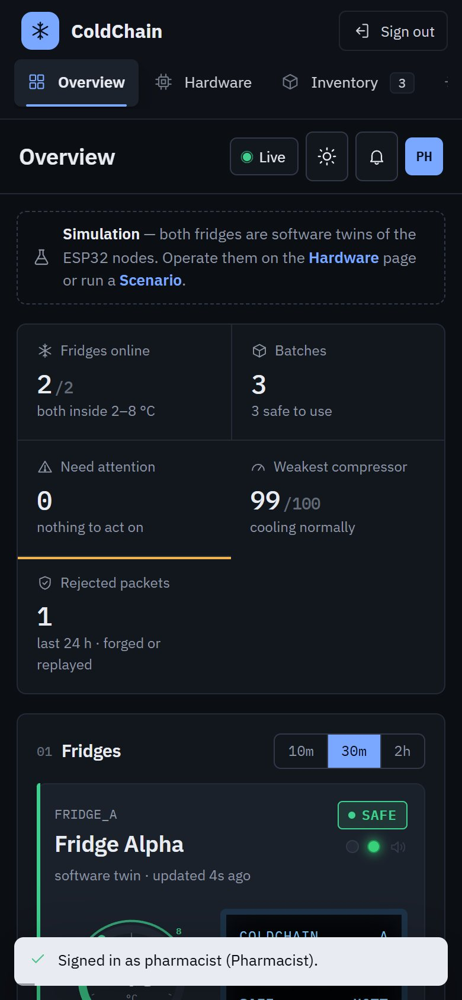
  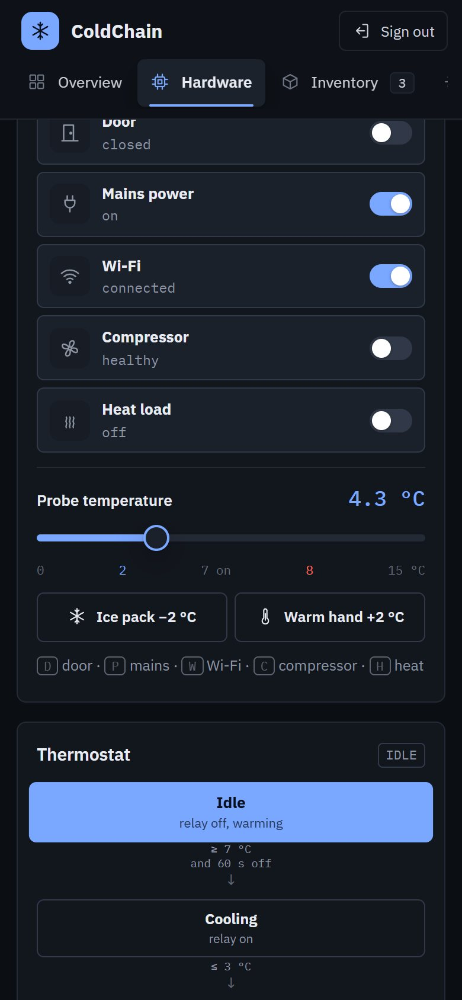
</p>

## 🧭 Architecture

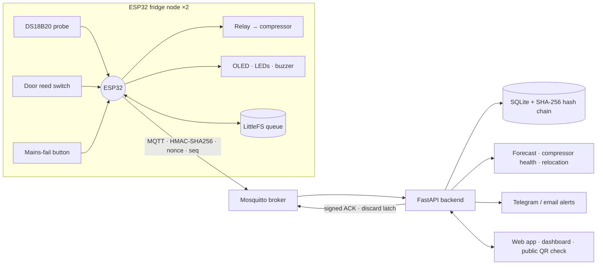

The node keeps working on its own: the thermostat, alarms and LEDs run on the ESP32 even when the
server or Wi-Fi is gone. The backend verifies every packet before it reaches the database.

## 🔬 How it works

<details>
<summary><b>Heat-exposure budget</b></summary>

Each accepted reading adds `Δt × weight` to every batch in that fridge while the previous sample was above
8 °C, with `weight = 2` above 12 °C. A batch has 3 600 weighted seconds. Gaps longer than 90 s are logged
and **not** filled with invented exposure. Status: *Safe* → *At risk* (< 20 % left) → *Discard* (0 %, latched).
</details>

<details>
<summary><b>Device security</b></summary>

The ESP32 signs `device|seq|observed_at|temp_c_100|door|mains|compressor|battery|sent_at|nonce` with a
per-device key (HMAC-SHA256). The server rejects packets with a bad signature, a timestamp outside ±120 s,
a reused nonce, an unknown device, an out-of-order sequence, or a reused sequence number with different
data — and logs every rejection. Identical retries are acknowledged once, so offline replay never creates duplicates.
</details>

<details>
<summary><b>Tamper-evident log</b></summary>

Every event stores `sha256(previous_hash | time | actor | action | data)`. Sensor readings are also compared
with their chained copy, so editing a stored temperature breaks *Verify integrity* at the exact record.
</details>

<details>
<summary><b>Forecast and compressor health</b></summary>

Features from the last 5 minutes: temperature, slope, mean, spread, door, mains, compressor state and duty.
A random forest (30 trees, depth 10) trained on 220 simulated fridge runs with power cuts, door openings and
weakening compressors, split by run so test runs are unseen:

| MAE | RMSE | Breach precision | Breach recall | F1 |
|---|---|---|---|---|
| 1.48 °C | 1.87 °C | 86.6 % | 87.0 % | 0.868 |

Compressor health = latest uninterrupted cooling run (°C/min) ÷ the fridge's best run, scaled 0–100.
Relocation picks the safest fridge (online, 2.5–6.5 °C, mains on, no forecast risk) and lists batches with the
least budget first. Details: [docs/AI_METHOD.md](docs/AI_METHOD.md).
</details>

## 🚀 Run it yourself

**Windows, one click:** double-click `START_DEMO_WINDOWS.bat`.

**Any OS:**

```bash
git clone https://github.com/Pranto-404/Coldchain.git
cd Coldchain
python -m venv .venv && . .venv/bin/activate      # Windows: .venv\Scripts\activate
pip install -r requirements.txt
python run_demo.py                                  # http://127.0.0.1:8000
```

**Docker (with an MQTT broker):** `docker compose up --build`

**Render:** [](https://render.com/deploy?repo=https://github.com/Pranto-404/Coldchain) — uses [`render.yaml`](render.yaml).

**Real hardware:** flash [`firmware/ColdChain_ESP32`](firmware/ColdChain_ESP32) to two ESP32 boards, then follow
[docs/HACKATHON_KIT.md](docs/HACKATHON_KIT.md) and [docs/ONSITE_DAY_GUIDE.md](docs/ONSITE_DAY_GUIDE.md).

| Variable | Purpose |
|---|---|
| `DEMO_MODE=1` | Run the two simulated nodes and demo accounts |
| `JWT_SECRET` | 32+ characters; required when `DEMO_MODE=0` |
| `DEVICE_FRIDGE_A_SECRET`, `DEVICE_FRIDGE_B_SECRET` | Per-device HMAC keys (live mode) |
| `MQTT_ENABLED`, `MQTT_HOST`, `MQTT_PORT` | Connect to the broker |
| `TELEGRAM_BOT_TOKEN` + `TELEGRAM_CHAT_ID`, or `SMTP_*` | Door-alert delivery |
| `PUBLIC_BASE_URL` | Address encoded in printed QR codes |
| `ALLOW_REGISTRATION=0` | Turn off self sign-up |

## 🗂 Project layout

```
coldchain/            FastAPI app, ingest + security, simulator, forecast, MQTT bridge, alerts
web/                  Front end (vanilla JS, no build step): dashboard, hardware view, themes
firmware/             ESP32 sketch, pin map, secrets template
models/ · report/     Trained forecast model, metrics, validation plot, competition PDF
tests/                pytest suite (41 tests) — run with: pytest -q
docs/                 Method, architecture, threat model, on-site guide, change logs
```

## ✅ Testing

```bash
pytest -q
```

Covers roles and permissions, HMAC / replay / stale-packet rejection, duplicate-free offline replay, the
12 °C double-count and discard latch, hash-chain tamper detection, relocation, sign-up and approval, the
simulator, and the forecast. CI runs the suite on every push.

## ⚠️ Limitations

ColdChain is a competition prototype, **not a certified medical device**. The forecast is trained on simulated
data and needs real fridge traces before field use; battery percentage needs a calibrated divider; the reference
relay circuit drives a low-voltage demo load only. See [docs/VALIDATION.md](docs/VALIDATION.md).

## 📜 Changelog

[V12](docs/V12_CHANGES.md) accounts, themes, manual hardware control ·
[V11](docs/V11_CHANGES.md) hardware view, redesign, deployment ·
[V10](docs/V10_CHANGES.md) audit fixes

---

<p align="center"><sub>Made for FastRoboX 1.0 by <a href="https://github.com/Pranto-404">@Pranto-404</a>.</sub></p>
